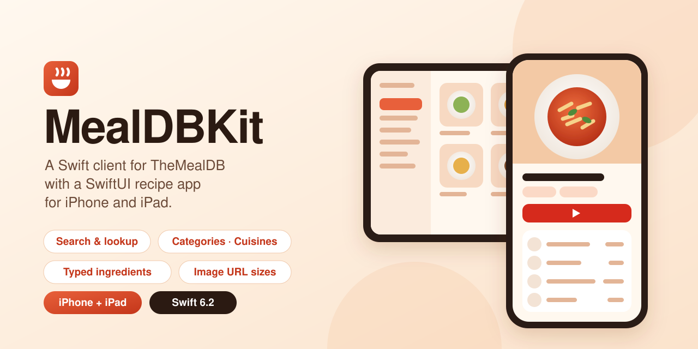
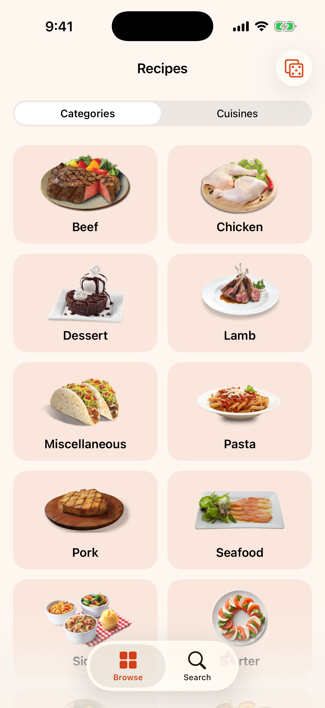
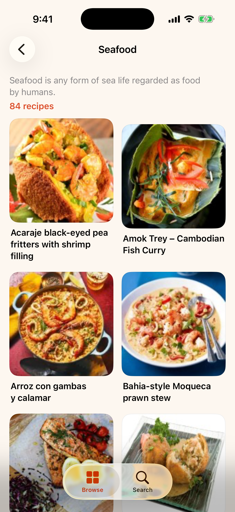
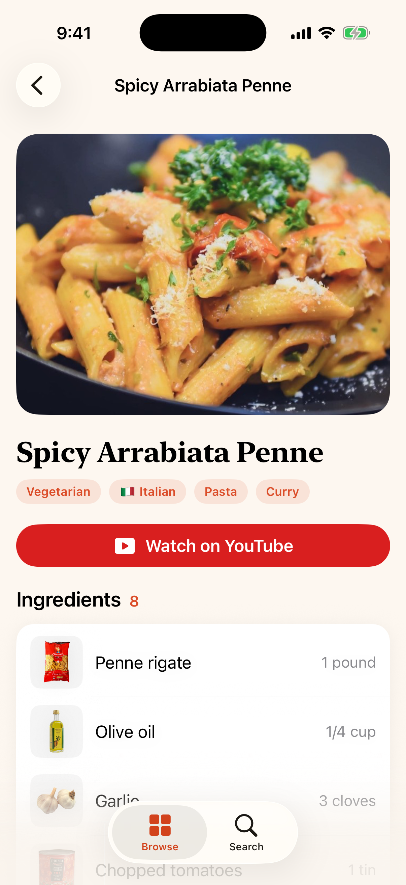
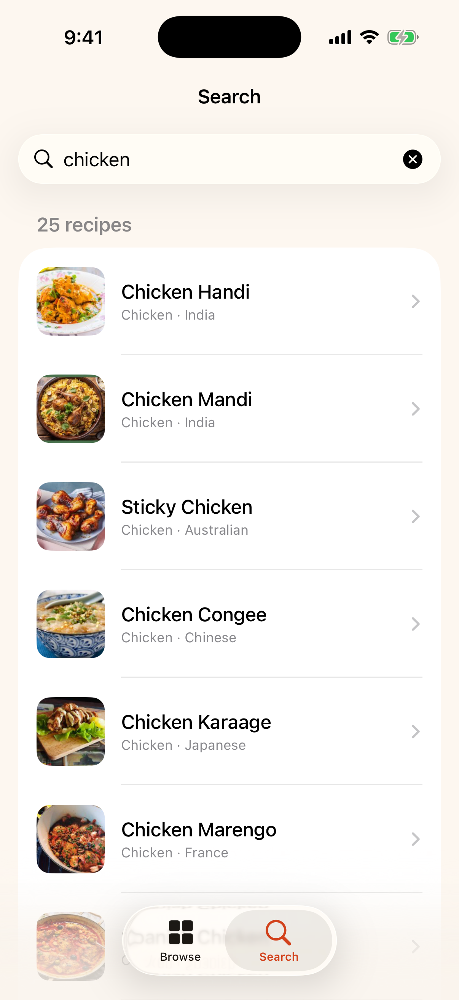
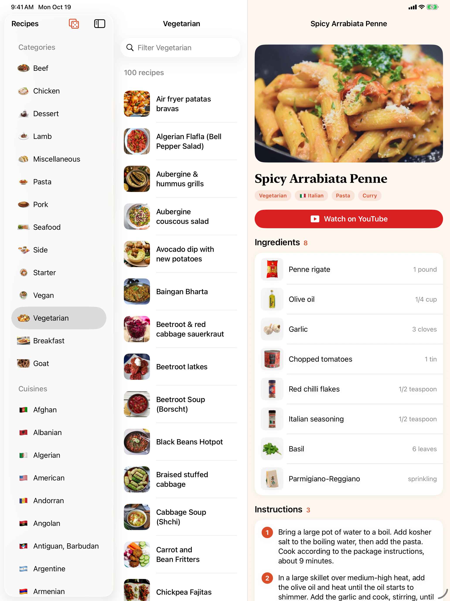

<p align="center">
  
</p>

<p align="center">
  <a href="https://github.com/halilozel1903/MealDBKit/actions/workflows/ci.yml"></a>
  
  
  
  
  
  <a href="LICENSE"></a>
</p>

**MealDBKit** is a Swift client for [TheMealDB](https://www.themealdb.com/api.php), the open, crowd-sourced recipe database, with SwiftUI views and a demo recipe app for **iPhone and iPad**. Search meals by name or first letter, look one up by id, get a random one, list categories, cuisines and ingredients, and filter by any of them. TheMealDB's twenty flat `strIngredientN` / `strMeasureN` field pairs become a typed ingredient list, `{"meals": null}` becomes an empty array, and photo and ingredient picture URLs come in every size the API serves. No dependencies.

```swift
import MealDBKit

let api = MealDBClient()                                       // the free test key "1"

let penne = try await api.searchMeals(name: "Arrabiata").first // Meal?
print(penne?.name ?? "", penne?.area ?? "")                    // "Spicy Arrabiata Penne" "Italian"

for ingredient in penne?.ingredients ?? [] {                   // [MealIngredient]
    print(ingredient.measure, ingredient.name)                 // "1 pound penne rigate" …
}
penne?.instructionSteps.count                                  // 3
penne?.thumbnailURL(size: .preview)                            // …/ustsqw1468250014.jpg/preview

let seafood = try await api.meals(inCategory: "Seafood")       // [MealSummary]
let recipe = try await api.meal(id: seafood[0].id)             // the full recipe
let nothing = try await api.searchMeals(name: "zzzz")          // [] — not an error
```

## Screenshots

Captured by CI from the example app, *Recipes*, on an iPhone and an iPad simulator, with real recipes and photos loaded live from TheMealDB with the free test key: the category grid, the Seafood category, Spicy Arrabiata Penne (meal 52771), a search for "chicken", and on iPad the Vegetarian category beside the Arrabiata recipe. Nothing is bundled or mocked; if the API or a photo cannot be loaded, the CI job fails instead of committing a screenshot.

| Categories | Seafood | Recipe | Search |
| :---: | :---: | :---: | :---: |
|  |  |  |  |



## Features

- **Every free endpoint**: search by name and by first letter, lookup by id, random meal, categories with pictures and descriptions, the category, cuisine and ingredient lists, and filters by category, cuisine and main ingredient. See the table below.
- **Typed ingredients**: the flat `strIngredient1` … `strIngredient20` and `strMeasure1` … `strMeasure20` fields become `[MealIngredient]` with `position`, `name` and `measure`. Blank names (`""`, `" "`, `null`) are skipped, values are trimmed, and a meal encodes back to TheMealDB's own flat shape.
- **No results is not an error**: `{"meals": null}`, a string such as `"Invalid ID"`, a missing key and an empty body all read as `[]`; `meal(id:)` returns `nil`.
- **Clean values**: blank strings become `nil`, `strTags` becomes `["Pasta", "Curry"]`, URLs are parsed, `strCreativeCommonsConfirmed` becomes a `Bool?`.
- **Instruction steps**: `instructionSteps` splits the instructions into lines, dropping blank lines, `STEP 1` headings and `1.` prefixes, so your view numbers them.
- **Image URLs**: meal photos at `.original`, `.preview`, `.small`, `.medium` and `.large`; ingredient pictures (`…/ingredients/lime-small.png`) at every size; YouTube video ids and thumbnails.
- **Cuisines with flags**: `MealArea` has the country code and flag emoji for TheMealDB's areas.
- **Your own key**: the free test key `"1"` is the default; pass a supporter key with `MealDBClient(apiKey:)`.
- **SwiftUI views** (`MealDBUI`): `MealCard`, `MealRow`, `CategoryTile`, `IngredientRow`, `InstructionSteps`, `TagChips` and `MealDBImage`, a cached image view whose loader you can replace through the environment.
- **Swift 6 ready**: `Sendable` models and client, strict concurrency, tested with Swift Testing against recorded JSON fixtures in the API's exact shapes.

## Installation

Add the package in Xcode (**File › Add Package Dependencies…**) with the URL

```
https://github.com/halilozel1903/MealDBKit
```

or in `Package.swift`:

```swift
dependencies: [
    .package(url: "https://github.com/halilozel1903/MealDBKit", from: "1.0.0"),
],
targets: [
    .target(name: "MyApp", dependencies: [
        .product(name: "MealDBKit", package: "MealDBKit"),
        .product(name: "MealDBUI", package: "MealDBKit"),   // optional SwiftUI views
    ]),
]
```

## Usage

### Search and look up

```swift
let api = MealDBClient()

let pies = try await api.searchMeals(name: "pie")           // [Meal], full recipes
let startingWithB = try await api.meals(startingWith: "b")  // [Meal]
let teriyaki = try await api.meal(id: "52772")              // Meal? (nil when there is none)
let surprise = try await api.randomMeal()                   // Meal
```

### Browse and filter

```swift
let categories = try await api.categories()                 // [MealCategory] with pictures
let cuisines = try await api.areas()                        // [MealArea]: American, British, …
let ingredients = try await api.ingredients()               // [Ingredient] with descriptions

let desserts = try await api.meals(inCategory: "Dessert")   // [MealSummary]
let canadian = try await api.meals(fromArea: "Canadian")    // [MealSummary]
let withChicken = try await api.meals(withIngredient: "chicken breast") // sent as chicken_breast

// Filters return an id, a name and a photo; load the recipes you need.
let recipes = try await api.meals(ids: desserts.prefix(5).map(\.id))
```

### Ingredients, steps and pictures

```swift
let meal = try await api.meal(id: "52771")!

for ingredient in meal.ingredients {
    print(ingredient.position, ingredient.name, ingredient.measure)
    ingredient.imageURL(size: .small)    // …/images/ingredients/penne%20rigate-small.png
}
for (number, step) in meal.instructionSteps.enumerated() {
    print(number + 1, step)
}
meal.thumbnailURL(size: .preview)        // a 250 × 250 thumbnail for lists
meal.youtubeVideoID                      // "1IszT_guI08"
meal.mealArea?.flag                      // "🇮🇹"
```

### SwiftUI

```swift
import MealDBUI

struct MealGrid: View {
    let meals: [MealSummary]

    var body: some View {
        LazyVGrid(columns: [GridItem(.adaptive(minimum: 160))]) {
            ForEach(meals) { MealCard(meal: $0) }
        }
    }
}

struct Ingredients: View {
    let meal: Meal

    var body: some View {
        ForEach(meal.ingredients) { IngredientRow(ingredient: $0) }
        InstructionSteps(meal: meal)
    }
}
```

Swap the image loader for your own cache, or for bundled artwork in previews:

```swift
ContentView()
    .mealDBImageLoader(MealDBImageLoader { url in try await MyCache.shared.data(for: url) })
```

## API

| TheMealDB endpoint | `MealDBClient` method | Returns |
| --- | --- | --- |
| `search.php?s=` | `searchMeals(name:)` | `[Meal]` |
| `search.php?f=` | `meals(startingWith:)` | `[Meal]` |
| `lookup.php?i=` | `meal(id:)` (`String` or `Int`), `meal(for:)`, `meals(ids:)` | `Meal?`, `[Meal]` |
| `random.php` | `randomMeal()` | `Meal` |
| `categories.php` | `categories()` | `[MealCategory]` |
| `list.php?c=list` | `categoryNames()` | `[String]` |
| `list.php?a=list` | `areas()` | `[MealArea]` |
| `list.php?i=list` | `ingredients()` | `[Ingredient]` |
| `filter.php?c=` | `meals(inCategory:)`, `meals(in:)` | `[MealSummary]` |
| `filter.php?a=` | `meals(fromArea:)`, `meals(from:)` | `[MealSummary]` |
| `filter.php?i=` | `meals(withIngredient:)` | `[MealSummary]` |

| Image helper | Result |
| --- | --- |
| `meal.thumbnailURL(size: .preview)` | `…/meals/<photo>.jpg/preview` (also `.small`, `.medium`, `.large`, `.original`) |
| `MealDBImages.mealImageURL(_:size:)` | Any photo URL at a size; resizing a resized URL replaces the size |
| `ingredient.imageURL(size: .medium)` | `…/images/ingredients/<name>-medium.png` (also `.small`, `.large`, `.original`) |
| `MealDBImages.ingredientImageURL(name:size:)` | The picture of any ingredient name |
| `meal.youtubeVideoID`, `MealDBImages.youtubeThumbnailURL(videoID:)` | The video id and its thumbnail |

Errors are `MealDBError`: `.invalidArgument` (such as a first-letter search with a symbol), `.emptyResponse` (no random meal), `.http`, `.decoding`, `.transport` and `.invalidResponse`. An empty result is never an error.

### Configuration

```swift
let api = MealDBClient(configuration: MealDBConfiguration(
    apiKey: "your-supporter-key",       // the default is the free test key "1"
    session: .shared,
    userAgent: "MyApp/1.0",
    timeout: 15
))
```

The free test key is meant for development and education. TheMealDB asks apps released to an app store to become supporters and use their own key; see TheMealDB's [API page](https://www.themealdb.com/api.php).

## Example app

`Example/` holds *Recipes*, an iPhone and iPad app built with XcodeGen:

- **iPhone**: a Browse tab with the category grid (or every cuisine with its flag) and a dice button for a random recipe, and a Search tab that searches by name or lists meals A to Z by first letter.
- **iPad**: a three-column split view with categories and cuisines in the sidebar, their meals in the middle and the recipe in the detail column.
- **Recipe page**: the photo, category, cuisine and tag chips, a Watch on YouTube button, every ingredient with its picture and measure (tap one to see other meals with it), and numbered instructions.

```bash
brew install xcodegen
cd Example && xcodegen generate && open MealDBDemo.xcodeproj
```

## Testing

```bash
swift test               # macOS
scripts/test.sh iOS      # on an iPhone simulator
```

The tests run against JSON fixtures in `Tests/MealDBKitTests/Fixtures`, served by a `URLProtocol` stub; nothing reaches the network. The fixtures are hand-written in TheMealDB's response shapes (shortened lists, a few real recipes); `meal-step-headings.json` is a made-up "Fixture Stew" that collects the messy shapes the API sends (step headings, blank and whitespace fields, `null` measures). Only the screenshots use the live API.

## Credits

Recipes and photos come from [TheMealDB](https://www.themealdb.com), a free, crowd-sourced database. This package is not affiliated with TheMealDB.

## License

MIT © Halil Özel. See [LICENSE](LICENSE).
